# SOMA: Spaceflight Organ Monitoring Application

Health monitoring for a crew that cannot call a doctor. Built for the NASA Space Apps Challenge 2026, "Create Health Monitoring Software for Astronauts on Space Missions".

> **Read this first.** The crew and its device feed are simulated. It is a concept demonstrator for a hackathon, not a medical device, and it has not been clinically validated.

**Live demo: https://space6ix-health-monitor.vercel.app**

**Put it on a phone like an app:** on iPhone, open the link in Safari, tap Share, then **Add to Home Screen**. On Android, open it in Chrome, tap the menu, then **Install app**. On a computer, click the install icon in Chrome's or Edge's address bar. SOMA then opens full screen with its own icon, and after the first visit it also starts without a connection.

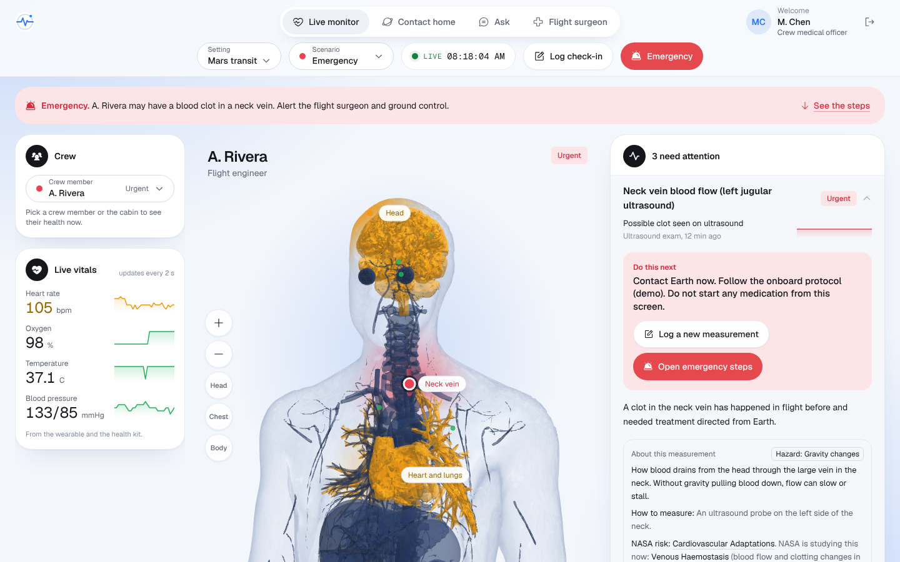

## The problem

On the way to Mars, a question to Earth and its answer can take more than 40 minutes. The crew has no doctor on board. And the body changes in space, so the normal ranges printed on an Earth lab report stop being reliable:

- Hematocrit rises about 10 to 12% in flight. An Earth rule calls that dehydration. It is expected.
- Cabin CO2 that passes Earth workplace limits still gives crews headaches. An Earth rule misses it.
- Passing 1.6 litres of urine a day is normal on Earth. In space, where bones shed calcium into the urine, it is a kidney stone risk.

## The idea

SOMA checks every reading with rules adapted to spaceflight. Each reading is compared with the person's own pre-flight value and with what is known from past missions, not with the normal ranges on an Earth lab report.

| | An Earth lab report | SOMA |
|---|---|---|
| Normal spaceflight change | False alarm | Explained as expected |
| Concern that only matters in space | Missed | Flagged, with what to do next |
| Where the rule comes from | Lab reference range | A published spaceflight source, linked on screen |

Any threshold without a published source is labelled "Demo parameter" on screen. Nothing unconfirmed is shown as fact.

How this maps to the challenge text, line by line, is in [CHALLENGE.md](CHALLENGE.md).

## NASA and partner resources used

The challenge lists these resources. This is where each one shows up in the app.

| Resource | How we use it |
|---|---|
| [NASA: five hazards of human spaceflight](https://www.nasa.gov/hrp/hazards/) | Every signal is tagged with its hazard, and each hazard has its own live scenario: a solar storm, isolation, Earth out of reach, landing day and cabin CO2. Each one links to NASA's page for its hazard and explains it in plain words |
| [NASA: risks of human spaceflight](https://www.nasa.gov/hrp/risks/) | Every signal links to its official NASA risk page (for example SANS, bone changes, food and nutrition, immune responses, sleep, behavioral changes, cardiovascular adaptations, radiation-induced cancers). Facts taken from those pages: bone loss of 1 to 1.5% a month, and about 70 percent of station astronauts with some swelling at the back of the eye. The hazard scenarios use the sleep, behavior and sensorimotor risk pages for their steps (light and a fixed sleep schedule, a journal, calls with family, dizziness after landing) |
| [NASA: ongoing research](https://www.nasa.gov/hrp/ongoing-hrp-research/) | Signals name the current NASA study on the same question: Venous Haemostasis (neck vein), Thigh Cuff (eyes), ARCHeR (sleep and mood), Immune Biomarkers (white cells), Zero T2 (exercise), Simulating Manual Piloting for Moon Landings (dizziness after landing: no piloting that day) |
| [Canadian Space Agency: monitoring radiation](https://www.asc-csa.gc.ca/eng/news/articles/2026/2026-02-26-monitoring-radiation-astronaut-health.asp) | The solar storm scenario's dosimeter step and the Radiation now signal cite it: neutrons make up about 30% of the dose on the station, measured with Canadian bubble detectors, with CANS, a compact neutron monitor, on the way |
| [Canadian Space Agency: why science in space](https://www.asc-csa.gc.ca/eng/iss/science/why-do-we-conduct-science-experiments-in-space.asp) | The mission settings follow its list of deep-space challenges: more weightlessness, more radiation, longer isolation, longer delays, less help from Earth. The Earth out of reach scenario cites it |

These pages give no numeric thresholds, so they do not replace our "Demo parameter" labels. NASA risks with no signal in this app: teamwork, low oxygen, decompression sickness, spacewalk injury, and microbes. Kidney stones are a signal here but are not on NASA's list of 17 risks.

## Why crew alerts use rules

The crew alert path uses the source-linked rules.

- **No data to learn from.** Day-by-day in-flight astronaut vitals are not public. A model trained on invented data would only learn our invention.
- **It has to run on board.** A spacecraft cannot wait 40 minutes for a cloud service. The rules run in the browser with no connection.
- **A crew far from help must see why.** Every flag shows its reason and its source, so the crew and the flight surgeon can check it. A model's score cannot be audited the same way.

## Features

### Live monitor

Live monitor is the first screen after sign-in. The page menu (Live monitor, Contact home, Ask, Flight surgeon) sits in the middle of the header, with the signed-in person on the left, the logo on the right, and the setting, scenario, clock and buttons centered under it. Live monitor opens on the signed-in person's own health and shows the crew as they are now: a LIVE clock in the header, and heart rate, oxygen, temperature and blood pressure that update every two seconds. Pick any crew member or the cabin from the **Crew** dropdown; each name shows its status (Normal, Check or Urgent), and the dropdown box takes the chosen person's status colour. Each signal on the right is a box filled with its status colour, so what needs attention stands out at a glance. After a check-in it shows the person the check-in was for.

The look is light and calm: white rounded cards on a soft blue background, black round icons and a white 3D body, so the status colours (green Normal, yellow Check, red Urgent) stand out.

A 3D body built from real anatomical models. The part of the body behind each flagged signal glows, and opening a signal moves the camera to it. Zoom with the scroll wheel or by pinching on a touch screen.

Each signal shows what to do next first, then the reason, then a plain explanation of the measurement (what it is, why it matters in space, how to take it), then where the reading came from.

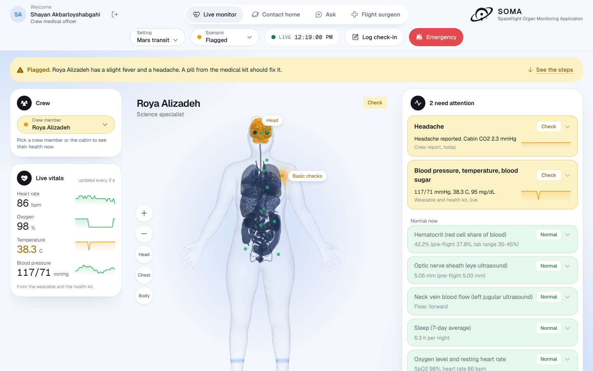

### Live scenarios

The **Scenario** menu in the header plays one of eight simulated situations for the whole crew: three about crew health, and one for each of NASA's five hazards of human spaceflight. Switching opens the person with the problem, or the cabin when everyone is affected.

| Scenario | What happens | What the steps do |
|---|---|---|
| Normal | Every astronaut and the cabin are normal | Nothing to fix; routine reminders |
| Flagged | Roya Alizadeh has a slight fever (about 38.3 C) and a headache | Give a fever and pain reliever from the medical kit, then watch the temperature come back to normal (about a minute in the demo, about an hour in real life). The problem then shows Fixed |
| Emergency | Khamosh Mehta may have a blood clot in the left neck vein, with a fast pulse | Alert the flight surgeon, see ground control get the alert after the signal delay, and get a second opinion from Earth |

#### NASA's five space hazards

Each hazard scenario is built from the challenge's NASA and CSA pages: the situation comes from the hazard page, and the steps cite the NASA risk pages, current NASA research and other NASA sources. The steps change the live feed, so the crew can see their actions work.

| Scenario | NASA hazard | What happens | What the crew does |
|---|---|---|---|
| Solar storm | Space radiation | Radiation in the cabin jumps to about 30 times normal (urgent) | Build the storm shelter from stowage bags (the dose rate where the crew is drops to a quarter, as measured on Artemis I), no spacewalks, read dosimeters, tell Earth's radiation team. The storm passes and the all-clear ticks itself |
| Isolation | Isolation and confinement | Khamosh Mehta's mood and sleep have been low all week | A private talk, a private call with Earth's behavioral health team, light and a fixed sleep schedule, a journal, time at the window or with the plants, a check-in again next week |
| Earth out of reach | Distance from Earth | Mars is behind the Sun, so there is no contact for about two weeks, and Roya Alizadeh has side pain and low urine (possible kidney stone) | The medical officer leads, checks danger signs, gives a pain reliever, water, a kidney scan, and writes a report that waits on board. Contact home is paused |
| Landing day | Gravity fields | Just landed on the Moon: Tulsi Gandhi is dizzy, with a fast pulse and low blood pressure | Lie down, water with salt, compression garment, move slowly with a crewmate, no piloting or moonwalk. Heart rate and blood pressure come back and it shows Fixed |
| Cabin CO2 | Hostile and closed environments | The main CO2 scrubber fails, CO2 climbs past NASA's 3 mmHg limit, and two crew get headaches | Switch on the backup CO2 removal, tell flight controllers, pause hard exercise, keep fans on. CO2 falls under the limit and the headaches pass |

The storm size, the caution and shelter levels (5 and 20 times normal) and the timings are demo values; NASA uses a caution level and a shelter level but does not publish the numbers on its page. Each demo plays hours or days in about a minute.

| Scenario menu | Solar storm |
|---|---|
| 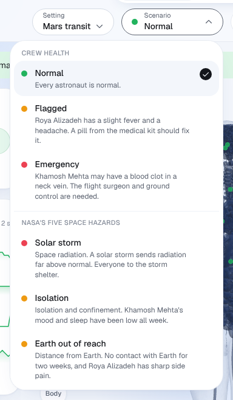 | 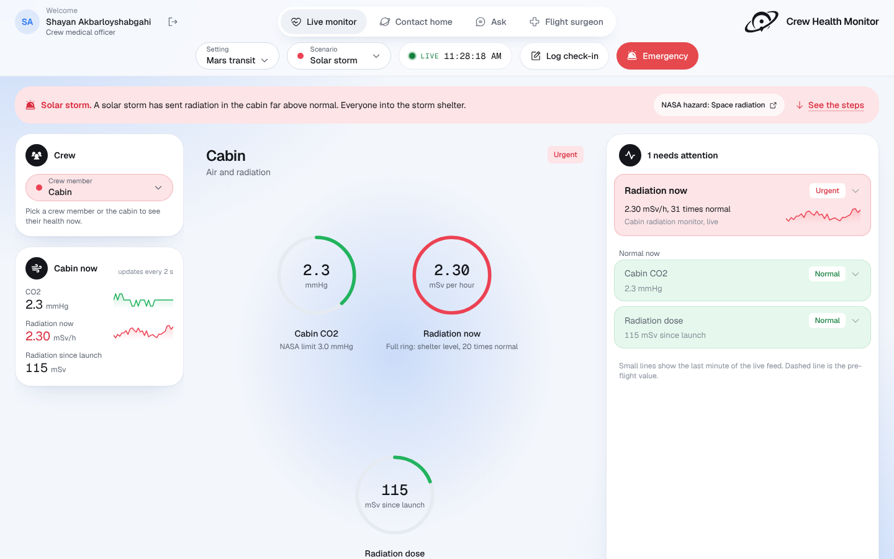 |
| **Landing day on the Moon** | **Earth out of reach** |
| 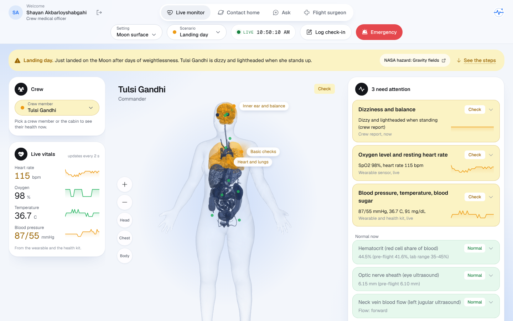 | 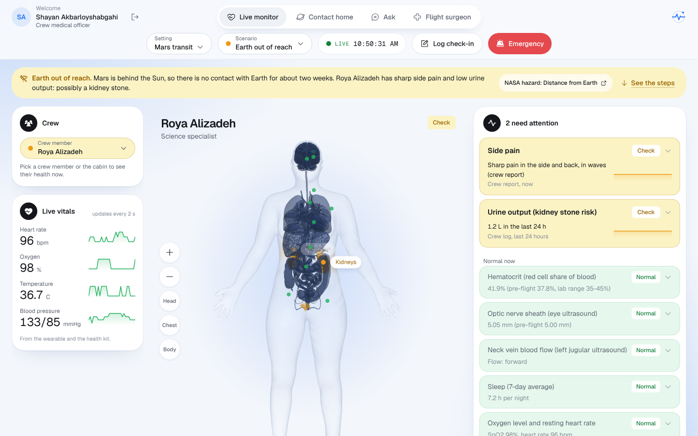 |

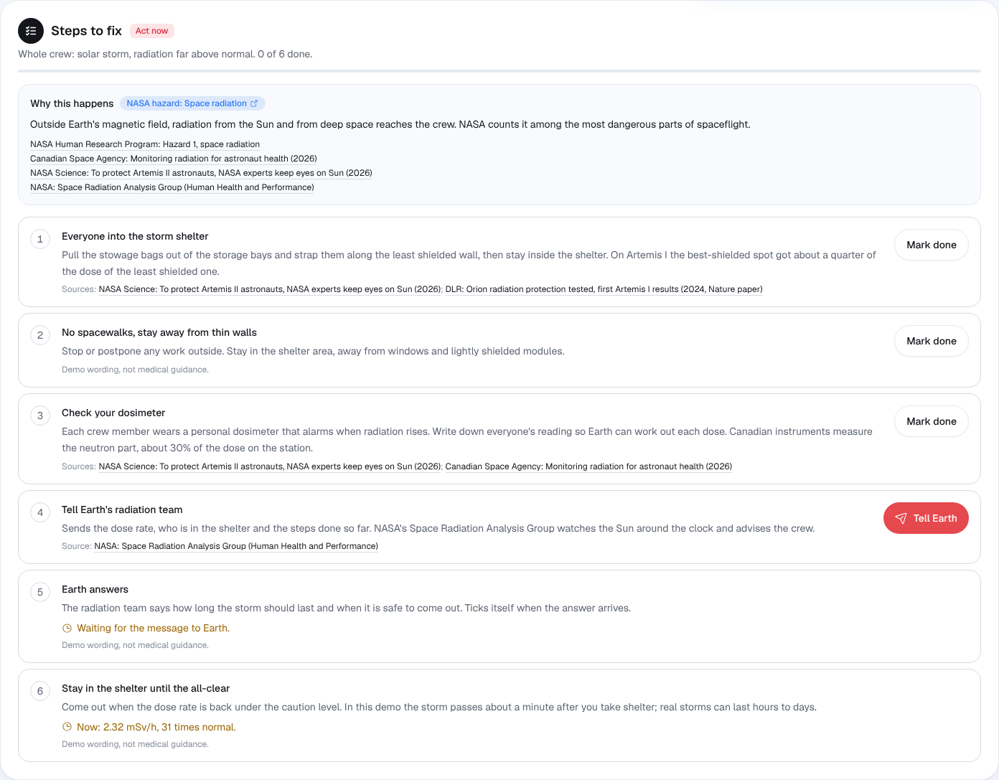

### Steps to fix

Under the body view is a checklist for the problem in the current scenario. Some steps are buttons that do something: mark the pill as taken, send the alert to Earth, open the check-in form. Others tick themselves: when the fever is gone, when the alert reaches Earth, when the answer comes back, when the problem's signals are back to normal. In the hazard scenarios a "Why this happens" box names the NASA hazard, explains it in plain words and links to the pages behind the steps. The alert travels through Contact home with the signal delay of the mission setting. A reply typed by the flight surgeon (signed in on a second tab) shows up as the second opinion; without one, an automatic answer arrives. Every step shows its source; steps without one are our own wording, not medical guidance.

| Flagged: a pill fixes it | Emergency: Earth has to help |
|---|---|
| 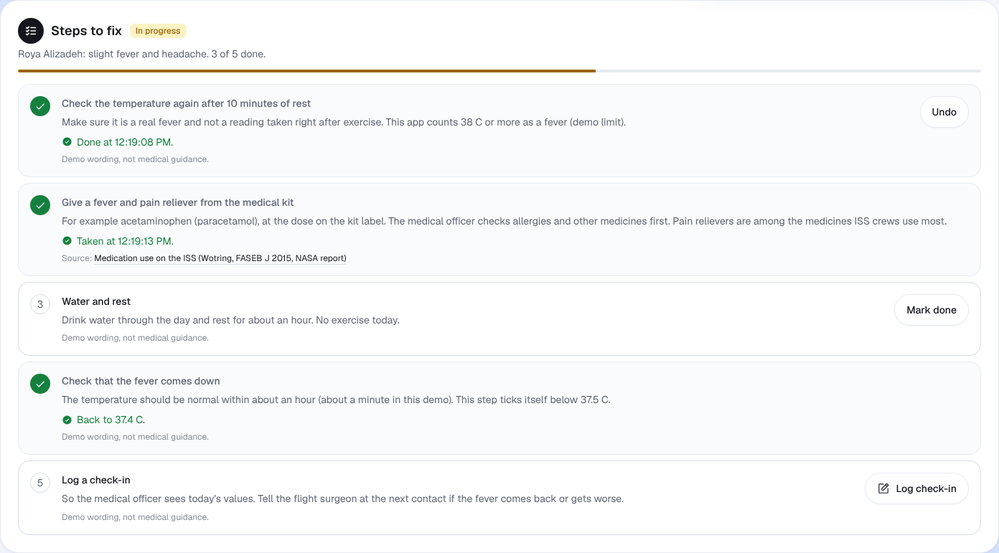 | 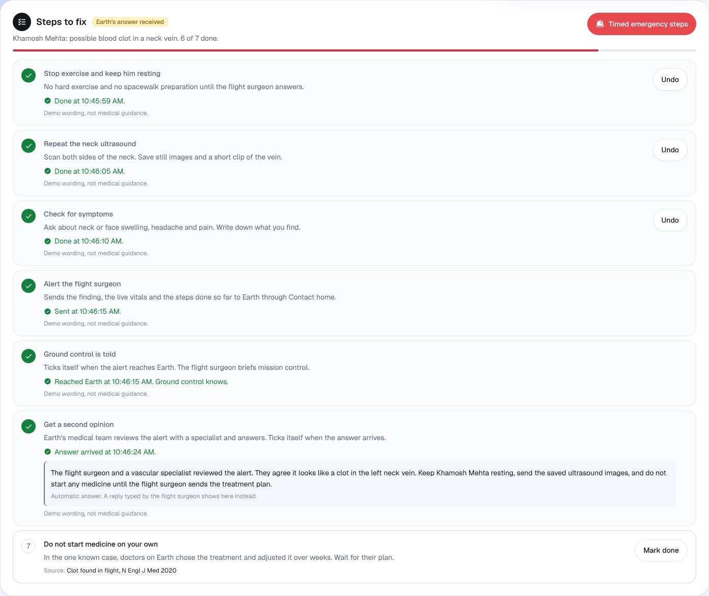 |

Crew members who are not the patient only see that a crew member needs help. The details stay with the medical officer.

### Signals

Thirteen crew signals and two cabin signals, each tagged with one of NASA's five hazards of spaceflight:

| Signal | Rule source |
|---|---|
| Hematocrit | Published |
| Optic nerve sheath (eye ultrasound) | Published, change threshold is a demo parameter |
| Neck vein blood flow | Published |
| Headache with cabin CO2 | Published |
| Urine output (kidney stones) | Published, to be re-checked |
| White blood cells and lymphocytes (immune) | In-flight rise published; action level is a demo parameter |
| Vitamin D (nutrition) | NASA protocol and flight studies, to be re-checked |
| Resistance exercise (bone loss) | Bone loss published, weekly cut-off is a demo parameter |
| Cabin CO2 | Published |
| Radiation dose | Published |
| Sleep | Demo parameter |
| Oxygen level and heart rate | Demo parameter |
| Mood | Demo parameter |
| Body mass (food intake) | Demo parameter |
| Blood pressure, temperature, blood sugar | Demo parameter (ordinary Earth limits) |

### Live trends

Up to three signals over the last two minutes of the live feed, against the crew member's pre-flight value.

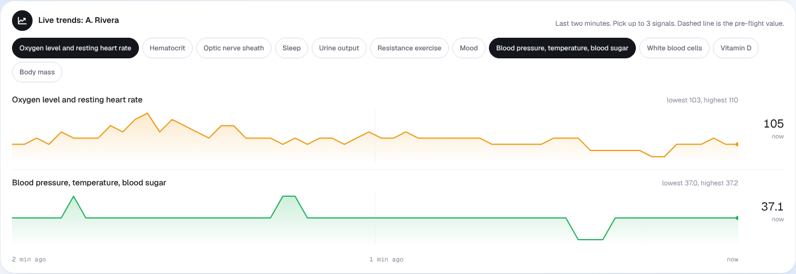

### Image attachment

A crew member can attach a photo or ultrasound image to a check-in. It is shrunk in the browser, stored with the check-in and shown with the eye signal. The app does not analyse the image and says so on screen. It is not yet sent to Earth with the report.

### Mission setting

Choose space station, Moon surface or Mars transit. The setting changes the signal delay to Earth (including for the Emergency alert), how fast radiation dose builds up, and, on the Moon, how strong the fluid shift toward the head is.

| Setting | One-way message delay | Radiation (dose equivalent) | Gravity |
|---|---|---|---|
| Space station | under 1 second (NASA) | 0.73 mSv a day (three peer-reviewed ISS measurements, 0.6 to 0.8) | Weightless |
| Moon surface | 1.3 seconds (distance divided by light speed) | 1.37 mSv a day (Chang'E-4, the only surface measurement so far) | One sixth of Earth |
| Mars transit | 4 to 22 minutes, by mission day | 1.8 mSv a day (Curiosity, measured in cruise) | Weightless |

**Moon gravity.** The space rules come from weightless missions. A parabolic-flight study found the neck vein widens step by step as gravity falls, but it only went down to a quarter of Earth gravity, and nobody has measured a long stay on the Moon. So in the Moon setting the simulation applies 60% of the weightless fluid shift, labelled as a demo parameter, and each gravity-related signal carries a note saying its rule was written for weightlessness.

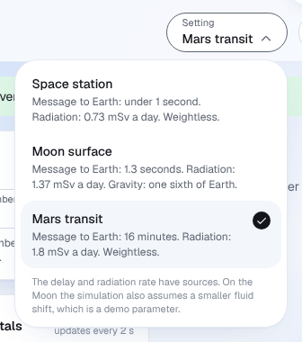

### Body systems

Switch between all systems, heart and blood, brain eyes and spine, and organs.

| Heart and blood | Female reference body |
|---|---|
| 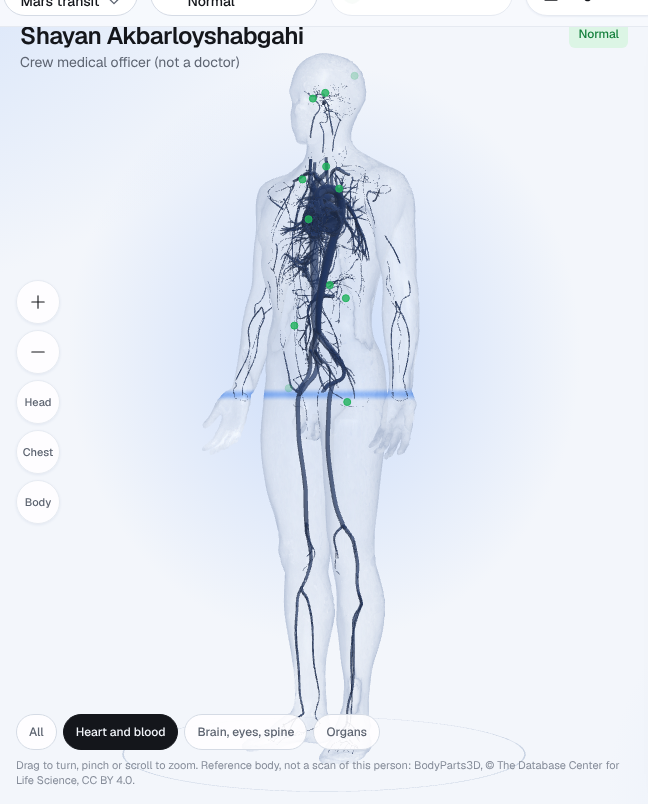 | 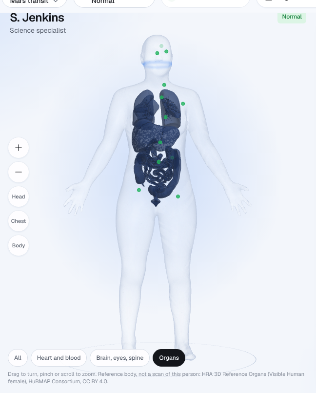 |

### Contact home

Messages and health reports to Earth travel with the signal delay for the mission day, with a countdown. The demo plays one minute of delay as one second. In the Earth out of reach scenario it is paused, and during a planned blackout from the Flight surgeon page too: nothing goes out, and messages from Earth wait until contact returns. Blackout plans, approvals and reports show with their own labels, and the flight surgeon approves a plan right in the thread.

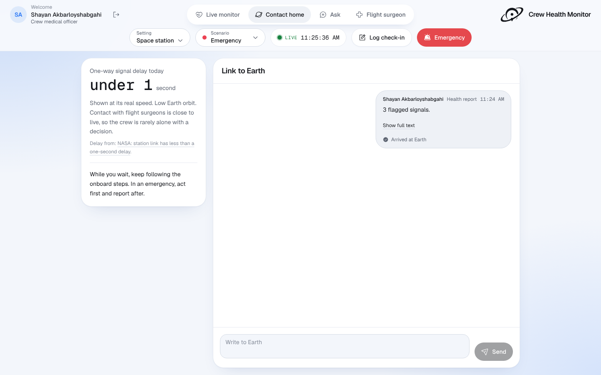

### Ask

An onboard guide that answers questions in plain words. It needs no AI model and no connection to Earth, which matters most when Earth is out of reach. It knows:

- **The crew right now:** "How is the crew?", "How is Roya Alizadeh?", "Is my oxygen normal?", "Who has a headache?". It uses everyone's live readings and says what to do.
- **The situation:** "What's happening right now?", "What should we do now?", "Why does this happen?". It knows the scenario being played and its steps.
- **NASA and CSA knowledge:** the five hazards, the 17 risks, NASA's current studies, and facts with numbers from the challenge's pages and the sources behind the rules (bone loss, SANS, fainting after landing, the Mars delay and solar conjunction, neutrons on the station, the storm shelter, CO2 limits, sleep, mood, kidney stones and more).
- **The app:** pages, check-ins, Emergency mode, Contact home and its delay, planning a blackout, who can see what.

Tap the microphone next to the question box to say a question instead of typing it. The words appear in the box as you speak, and the question is asked when you stop talking (tap the red button to stop early). The browser turns speech into text: it works in Chrome, Edge and Safari, and in Chrome it uses Google's online speech service, so typing is the way to ask with no internet. The app does not record or keep any audio.

It understands follow-ups ("what should she do?", "why?"), copes with spelling mistakes, and links every answer to where it comes from. When it does not know, it says so and suggests the closest topics instead of guessing. The guide lives in `src/handbook.ts` and is tested in `src/handbook.test.ts`.

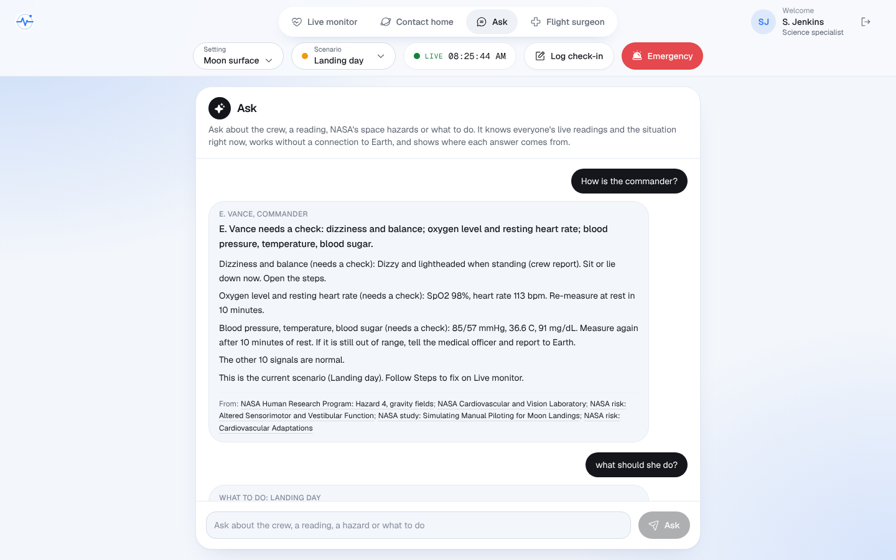

### Flight surgeon: planning a blackout

Sometimes there is no contact with Earth for 90 minutes. This page plans for it with the flight surgeon before it starts, then tells the crew what to do next while they are on their own. Three steps, one at a time:

1. **Plan with the flight surgeon.** The app makes the plan from Live monitor right now: who to watch and why, a step every 15 minutes or so, and what to do if something happens (someone collapses, a headache, a fever, dizziness, the radiation alarm, anything else). Add a question and press **Send plan to the flight surgeon**. On Earth, the flight surgeon opens it in Contact home and presses **Approve plan**, with any instructions. If nobody on Earth answers, an automatic approval arrives after the signal delay, labelled as automatic.
2. **Blackout.** Press **Start the blackout**: the crew's last message goes to Earth, then contact is lost. The page counts down the 90 minutes and shows one thing to do now, with **Done**. The flight surgeon's instructions stay on screen, **If this happens** has the agreed rules with **Open Emergency mode** for the urgent one, and a log records what was given and when. Nothing can be sent or received: Contact home and the report button are paused, and a chip in the header shows the time left.
3. **Report back.** When contact returns, the report lists the steps done and missed and the log. **Send report to the flight surgeon** sends it through Contact home.

The demo plays one minute of the blackout as one second, and **Skip ahead 15 min** and **Contact is back** move it along. The plan is kept in the browser, so a reload does not lose it. The logic is in `src/data/blackoutPlan.ts`, tested in `src/data/blackoutPlan.test.ts`. More in [the blackout notes](docs/FLIGHT_SURGEON_BLACKOUT.md).

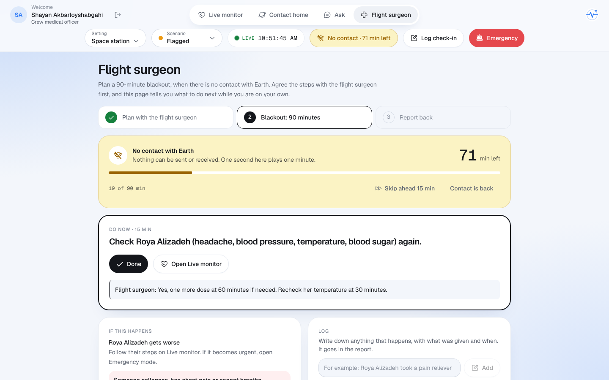

| Plan and send | The flight surgeon approves |
|---|---|
| 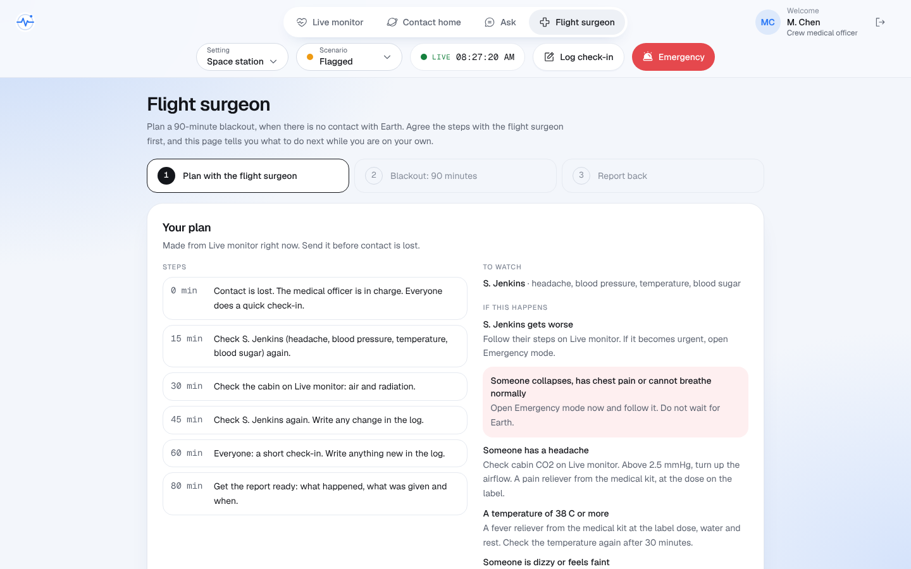 | 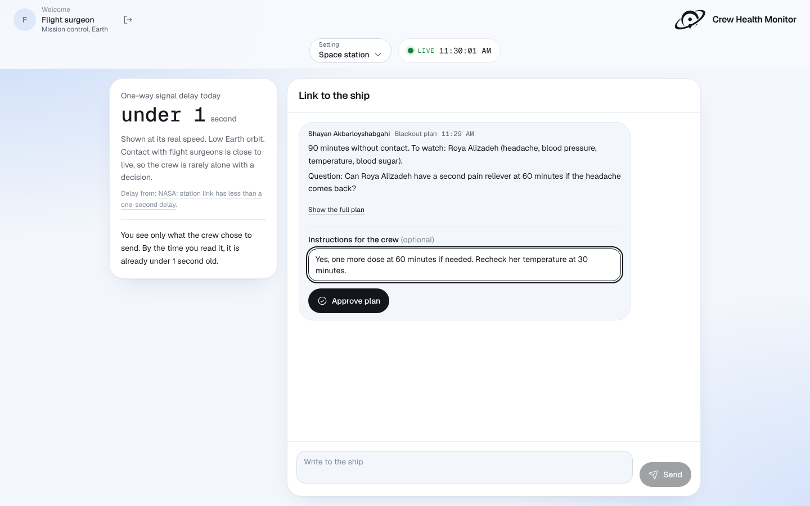 |

### Emergency

Step-by-step walkthroughs with large controls. The screen points to the scenario the sensors suggest. Every step is marked as coming from a published source or as demo wording. The run is timed, saved, and sent to Earth.

| Choose the scenario | Follow the steps |
|---|---|
| 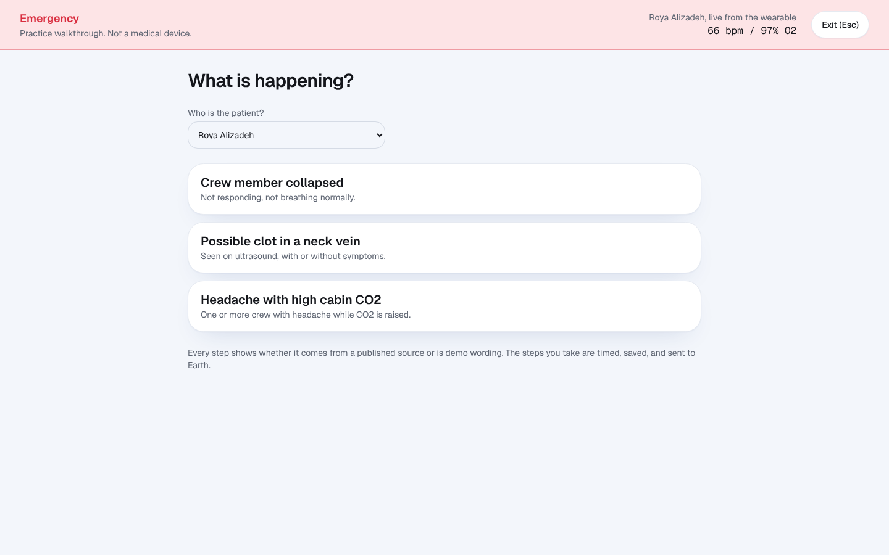 | 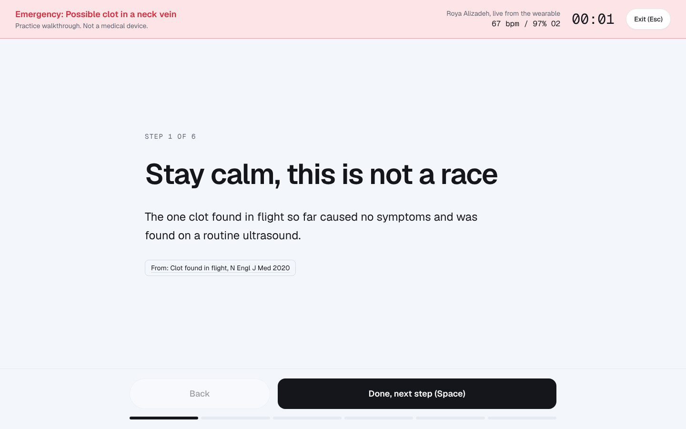 |

### Sign-in and who sees what

Choose a person to sign in. There is no PIN in this demo. On board, everyone can switch between crew members and see the whole crew's health: in a crew of four, crewmates help each other with measurements and look out for each other.

| Role | Sees |
|---|---|
| Crew member | The whole crew and the cabin; can log a check-in for anyone |
| Crew medical officer | The same, and can clear check-ins |
| Flight surgeon on Earth | Only what the crew sent, after the delay |

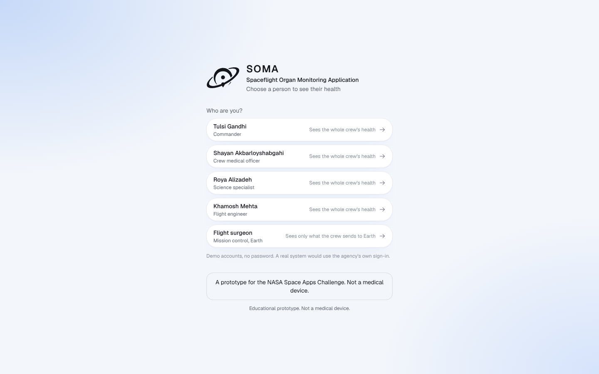

## What we added in Iteration 1

### Cardiovascular panel

Open **Live monitor**, choose **Heart and blood**, then select the **Blood** marker. The panel beside the 3D body shows live resting heart rate and blood pressure for the selected crew member. Each value says whether it is live or from a crew check-in. **Open check-in** starts the existing form for that crew member and day.

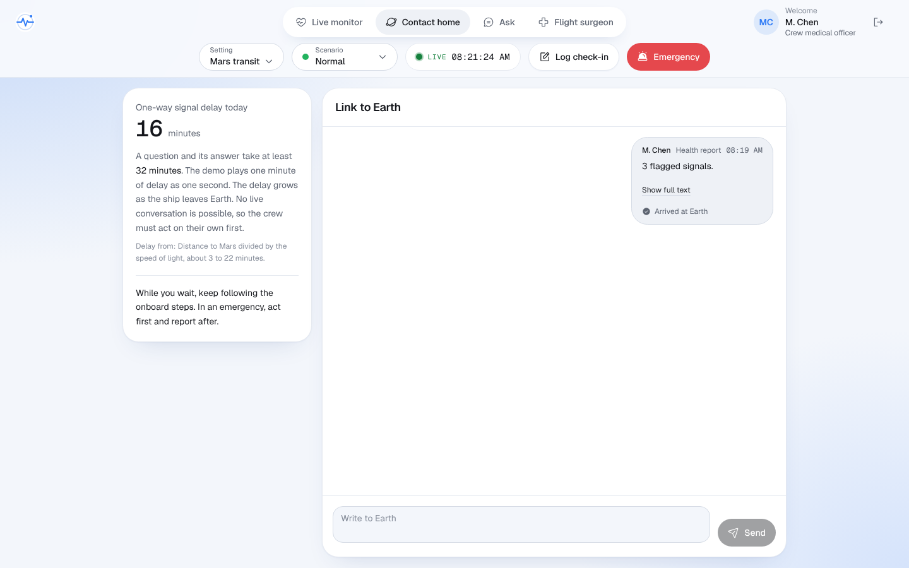

### Flight surgeon

Iteration 1 added a practice drill for 90 minutes without contact with Earth. It is now the blackout planner: see [Flight surgeon: planning a blackout](#flight-surgeon-planning-a-blackout) above.

### NASA datasets and backend

| Source | What we added |
|---|---|
| OSD-569 | Ingestion of the existing blood-count CSV, including matched preflight and postflight hematocrit comparisons |
| OSD-575 | Metabolic panel and cardiovascular serum markers, including glucose, calcium, alkaline phosphatase and CRP |
| OSD-656 | Human urine immune-protein measurements |
| OSD-804 | Mouse bone micro-CT measurements, grouped by cohort and specimen |
| RadLab | Environmental radiation readings from ISS DosTel1, lunar-orbit CRaTER-D1D2 and Curiosity's MSL-RAD-Surface |

The Python pipeline records units, sample times, checksums and data quality. The Node API adds authenticated research queries with filters and pagination, crew vitals with source labels, and radiation telemetry by instrument. The existing sign-in keeps private crew vitals limited to the crew member and the medical officer. See [datasets](docs/DATASETS.md) and the [API guide](docs/API_INTEGRATION.md).

### Anomaly experiments

| Experiment | What we measured |
|---|---|
| Simulated crew vitals | Trained an Isolation Forest on simulated readings. On held-out simulated crew-days it scored 0.604 F1 and caught 49% of injected anomaly days. |
| NASA radiation telemetry | Compared fixed median/MAD, a periodic rolling baseline and Isolation Forest separately for each instrument. Test results report how often each method flagged readings and how much the flags overlapped. The telemetry has no verified event labels. |

The experiments run offline after the data is available. Crew alerts still use the existing source-linked rules. See the [crew model card](docs/ML_MODEL_CARD.md) and [RadLab experiment](docs/RADIATION_EXPERIMENT.md).

## Live demo versus local

The public link and a local run are not the same thing. Please do not judge the privacy claims from the public link.

| | Local run (`npm run dev`) | Live demo link |
|---|---|---|
| Server and database | Yes: Node API with SQLite | None. The app answers its own calls inside the browser |
| Roles and privacy | Enforced by the server | For show only |
| Contact home | Works between any browsers using the server | Works between tabs of one browser |
| Cardiovascular data | Live crew vitals | Live crew vitals |
| Where data is kept | Database file on the machine | That browser's storage |


## Run it

Needs Node 24 or newer. The core demo runs locally. To load the NASA research bundle and reproduce the experiments, follow the [Python setup and commands](docs/REPRODUCIBILITY.md).

```bash
npm install
npm run dev
```

Open http://localhost:5173 and choose a person: Live monitor opens on their health. Pick a scenario in the header. To see the Earth side, choose "Flight surgeon" in a second browser tab, with the same mission setting.

```bash
npm test
```

A three-minute walkthrough for presenting it is in [DEMO_SCRIPT.md](DEMO_SCRIPT.md).

## Deploy on Vercel

The repository deploys to Vercel as it is (see `vercel.json`): Vite builds the page, and `api/reword.js` becomes the only server function. The SQLite server does not run on Vercel, so the page answers its own calls in the browser (see "Live demo versus local" above).

1. In Vercel, choose Add New, then Project, and import this GitHub repository. Keep the detected settings.
2. Every push to `main` deploys to production. Other branches get their own preview links.

After rebuilding the NASA research bundle (`python -m ml.ingest`), run `npm run research:snapshot` and commit `public/research/hematocrit.json`, so the live link shows the same hematocrit comparison.

## How it is built

| Part | Where |
|---|---|
| Rules, as tested pure functions | `src/triage.ts` |
| Source for every threshold | `src/data/sources.ts`, notes in `RESEARCH_LOG.md` |
| Plain-language guide to each measurement | `src/data/signalGuide.ts` |
| Simulated crew and device feed | `src/data/simulatedCrew.ts`, `src/model.ts` |
| Live scenarios, including the five NASA hazard scenarios: the simulated feed right now | `src/live.ts` |
| Steps to fix, and the NASA hazard behind each scenario | `src/data/careSteps.ts`, `src/CareSteps.tsx`, `HAZARD_INFO` in `src/data/signalGuide.ts` |
| API and SQLite database | `server/index.ts` |
| In-browser stand-in for the server | `src/localBackend.ts` |
| 3D body | `src/BodyScan.tsx`, `src/body/anatomy.ts`, `public/anatomy/` |
| Screens | `src/SignIn.tsx`, `src/Overview.tsx` (Live monitor), `src/EarthLink.tsx` (Contact home), `src/Ask.tsx`, `src/FlightSurgeon.tsx`, `src/Emergency.tsx` |
| Crew readings for the Cardiovascular panel, shared by the server and the browser | `src/crewVitals.ts` |
| Ask: the onboard guide (knowledge, live answers, follow-ups) | `src/handbook.ts` |

Stack: React, TypeScript, Vite, Tailwind, Motion, three.js. The backend uses only what ships with Node (its built-in web server and SQLite), and imports the same rule file as the screens, so there is one copy of the rules.

First load: the 3D view and its 13 MB model file load only when Live monitor is opened.

## What is real and what is simulated

| Real | Simulated |
|---|---|
| The published sources behind each rule | The crew and their accounts |
| Lab ranges and pre-flight blood values (NASA OSDR dataset OSD-569) | Every day-by-day reading |
| Radiation rate measured on the way to Mars | The device feed and its schedules |
| The organ and body models | Emergency steps marked "demo only" |
| The clot case and medication study behind the scenario steps | The eight live scenarios and the answers from Earth when no one replies |
| NASA's five hazard pages, risk pages and the sources behind each hazard step | Storm size, caution and shelter levels, and how fast each problem eases (demo values) |

## What it would take to be real

This is a prototype. It is not deployable, and we do not claim it is. A real system would need:

- Integration with real devices instead of a simulated feed.
- The agency's own identity system. Here anyone can choose any demo account, with no password.
- Encryption of data at rest and in transit.
- Clinical validation of every threshold, including the ones that have a published source.
- Peripheral nerves and a matched female vessel model, which the free anatomical datasets do not include.
- Images sent to Earth with the report, and any reading of them. Today an image is only stored and shown.
- Measured data for long stays in Moon gravity. The 60% fluid shift is an assumption, and bone loss, mission length and crew routines do not change with the setting.

## Optional: Gemini rewording

Ask works with no AI model. If you want friendlier wording, it can pass the guide's answer to Gemini to be reworded. Gemini only rewrites text the guide already chose, and the original answer stays visible under it. This needs internet, so it is a demo extra, not something for a spacecraft. It is off unless a key is set (the Vercel project has none today). If you turn it on, say in the submission that AI is used and how, as the Space Apps guide asks.

- Locally: copy `.env.example` to `.env` and put your key after `GEMINI_API_KEY=`.
- On Vercel: Project, Settings, Environment Variables, add `GEMINI_API_KEY`, then redeploy.

The key stays on the server (`api/reword.js`). It is never sent to the browser and `.env` is not committed.

## Credits

- Male body, organs and vessels: BodyParts3D, © The Database Center for Life Science, licensed under CC Attribution 4.0 International. Simplified for the web. The left neck vein is the right one mirrored.
- Female body, organs and vessels: HRA 3D Reference Organs (Visible Human female), HuBMAP Consortium, CC BY 4.0. Simplified for the web.
- Blood count data: NASA Open Science Data Repository, OSD-569.
- Type: Geist. Icons: Phosphor.

The mark in the header is our own. It is not a NASA logo.
